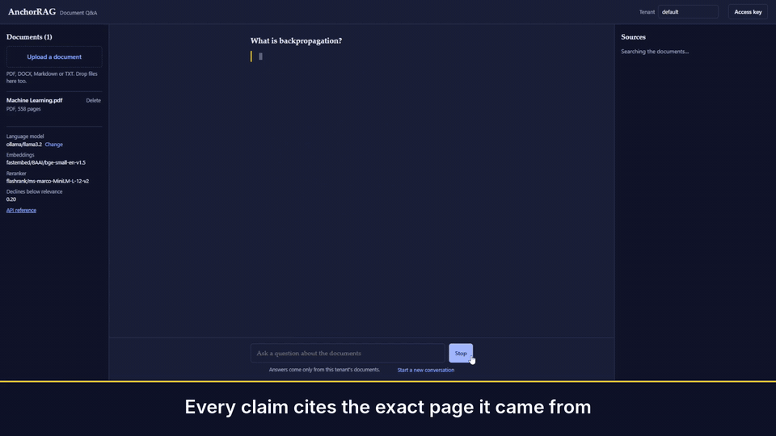
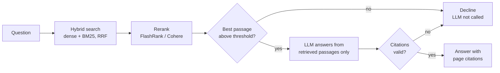

# AnchorRAG

**A self-hosted document Q&A backend that cites its sources and says "I don't know" instead of making things up.**

Upload PDF, DOCX, Markdown or text files, ask questions in plain language, and get answers that point to the exact page or section they came from. When the documents don't contain the answer, AnchorRAG declines. In that case it doesn't even call the language model.




Video link: https://youtu.be/ZwMOPm98sDk

**[Get AnchorRAG on Gumroad](https://codefoundry.gumroad.com/l/AnchorRAG?utm_source=github)**: one-time purchase, full source code, no subscription.

> This repository holds the documentation, evaluation results and demo media.
> The source code is distributed through Gumroad.

---

## Why AnchorRAG

Most RAG tutorials stop at a demo that answers every question confidently, including the ones its documents don't cover. AnchorRAG is built around the opposite rule: **decline rather than guess.**

| | Typical RAG demo | AnchorRAG |
|---|---|---|
| Retrieval | Dense vectors only | Hybrid dense + BM25 with RRF fusion, then reranking |
| Out-of-scope questions | Answers anyway | Confidence gate declines before the LLM is called |
| Citations | Optional, unchecked | Inline `[1]` citations, validated after generation |
| Provenance | "Somewhere in the file" | Exact page (PDF) or heading path (DOCX, Markdown) |
| Users | Single user | Multi-tenant, API keys, rate limiting |
| Quality | "Looks good to me" | Bundled evaluation suite with pass/fail gates |

## Features

- **Multi-format ingestion**: PDF, DOCX, Markdown and TXT, with running headers stripped, duplicates detected and per-document metadata
- **Hybrid search**: dense embeddings (FastEmbed `bge-small-en-v1.5`) + BM25 sparse vectors in Qdrant, fused with Reciprocal Rank Fusion
- **Reranking**: local FlashRank by default, Cohere Rerank optional
- **Grounded answers**: a confidence threshold, a strict prompt, citation validation and refusal detection
- **Streaming**: `/chat/stream` over Server-Sent Events, with sources sent first
- **Bring your own model**: OpenAI, Anthropic or a fully local Ollama model, connected from the web UI. Your documents never have to leave your machine.
- **Multi-tenancy**: isolated document sets per tenant; API keys can be bound to a tenant
- **Production basics**: rate limiting, upload limits, structured JSON logs with request IDs, health checks
- **Web UI included**: upload, ask, inspect sources and relevance scores
- **Docker Compose**: one command to run; Makefile, `.env.example`, 275 pytest tests

## How it works



Every chunk belongs to exactly one PDF page or one heading path, which keeps citations exact.

## Measured, not claimed

Results from the bundled evaluation suite (34 labelled questions over the sample documents), using a **free local 3B model** (`ollama/llama3.2`) on a laptop CPU:

| Metric | Result |
|---|---|
| Retrieval hit rate@5 | **100%** (28/28) |
| MRR, hybrid + rerank | 0.976 |
| Answerable questions answered correctly | 23/28 (82%) |
| Out-of-scope questions correctly declined | **6/6 (100%)** |
| Out-of-scope questions answered anyway | 0/6 |
| Latency p50 / p95 | 916 ms / 1140 ms |

The four questions it wrongly declined were phrased very differently from the documents. The kit declined rather than guess. The full report lists every such case with its relevance score, so you can tune the threshold or switch models and measure again with `make eval`.

## API at a glance

```bash
curl -X POST http://localhost:8000/api/v1/chat \
  -H "Content-Type: application/json" -H "X-Tenant-ID: acme" \
  -d '{"question": "How many weeks of parental leave do primary caregivers get?"}'
```

```json
{
  "answer": "Primary caregivers receive 16 weeks of fully paid parental leave following the birth or adoption of a child [1].",
  "answered": true,
  "citations": [
    { "index": 1, "filename": "Employee_Benefits_Handbook.pdf", "page_number": 5, "relevance_score": 0.97 }
  ]
}
```

When the documents don't contain the answer:

```json
{
  "answer": "The provided documents do not contain sufficient information to answer this question.",
  "answered": false,
  "refusal_reason": "low_confidence",
  "citations": []
}
```

| Method | Path | Purpose |
|---|---|---|
| `POST` | `/api/v1/documents/ingest` | Upload and index a file |
| `GET` | `/api/v1/documents` | List documents |
| `DELETE` | `/api/v1/documents/{id}` | Delete a document and its vectors |
| `POST` | `/api/v1/search` | Retrieval only, no LLM |
| `POST` | `/api/v1/chat` | Grounded answer with citations |
| `POST` | `/api/v1/chat/stream` | The same, streamed (SSE) |

## Tech stack

Python 3.11+ · FastAPI · Pydantic v2 · Qdrant · FastEmbed · FlashRank · Docker Compose. There is no LangChain or LlamaIndex: about 5,000 lines of typed, documented Python that you can read in an afternoon and change anywhere.

## What you get

- Full source code with architecture documentation
- Docker Compose setup, Makefile and `.env.example`
- Web UI with guided model setup
- Sample documents and a seed script
- Evaluation suite: hit rate, MRR, refusal accuracy and LLM-judged faithfulness
- 275 tests that run offline

**Requirements:** Docker with Compose v2.24+, plus either an OpenAI or Anthropic API key or a local Ollama install, which needs no key.

## Who it's for

- **Freelancers and agencies** who need to ship "chat with our documents" for a client this week
- **Backend developers** building an internal knowledge assistant that must not hallucinate
- **Teams with private data** who want everything local with Ollama
- **AI engineers** who want a readable, tested reference for production RAG

## FAQ

**Is this a hosted service?** No. You run it on your own machine or server. Your documents and API keys stay with you.

**Do I need an OpenAI key?** No. It works fully offline with Ollama. OpenAI and Anthropic are optional.

**Can I use it in client projects?** Yes, see the license included with the purchase.

**Which languages does it support?** The default embedding and reranking models are English. Both can be swapped for multilingual models in the configuration.

---

**[Get AnchorRAG on Gumroad](https://codefoundry.gumroad.com/l/AnchorRAG?utm_source=github)**

Questions or feedback? Open an [issue](https://github.com/B1mish/Anchorrag/issues).
